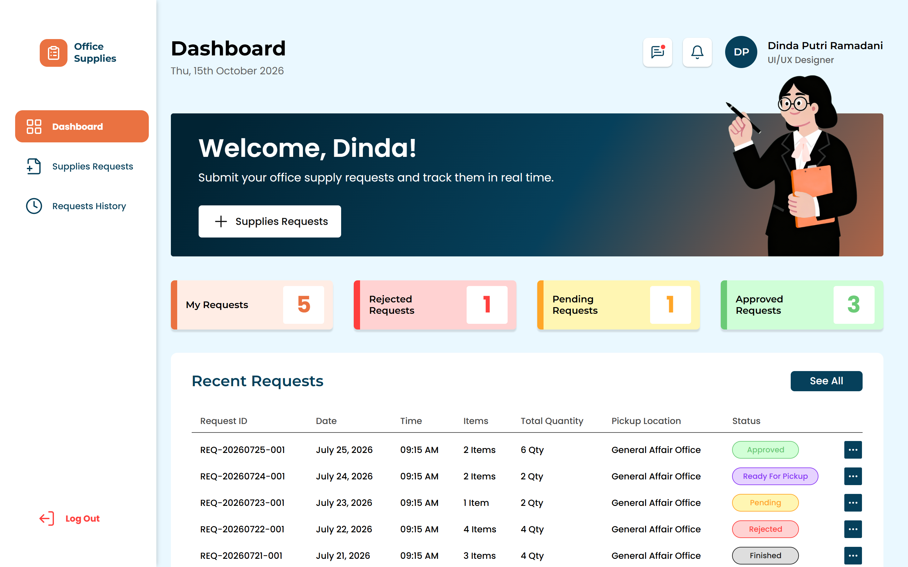
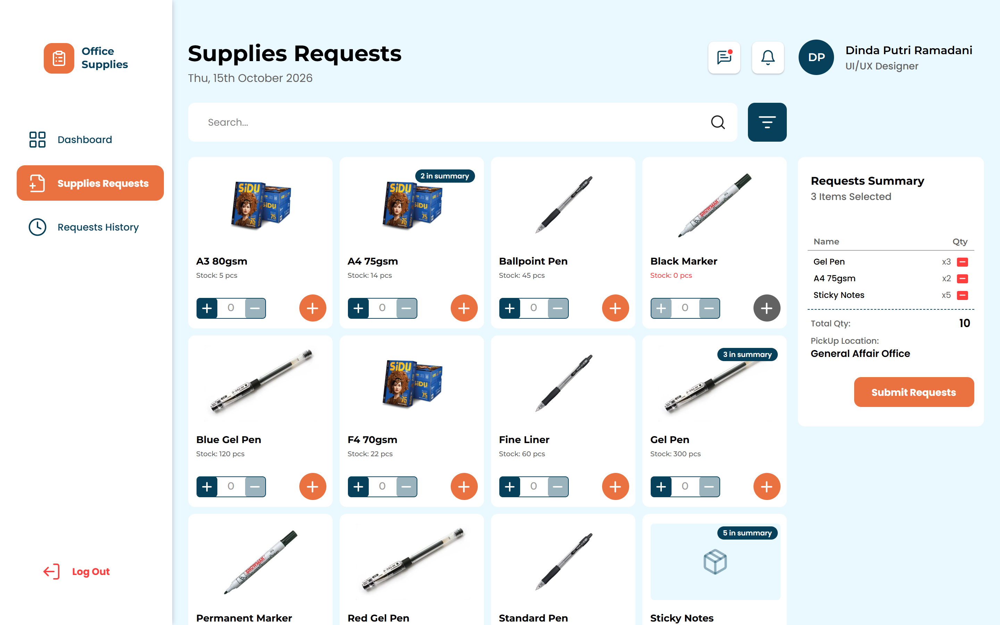
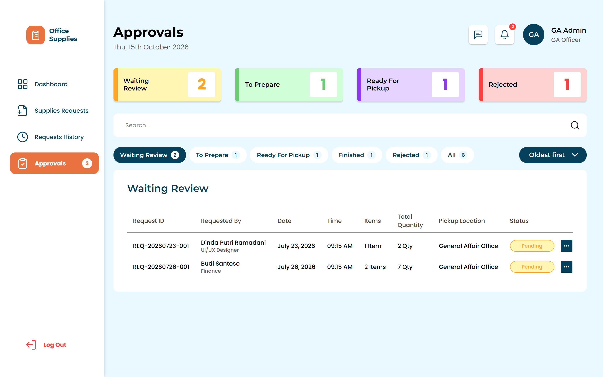
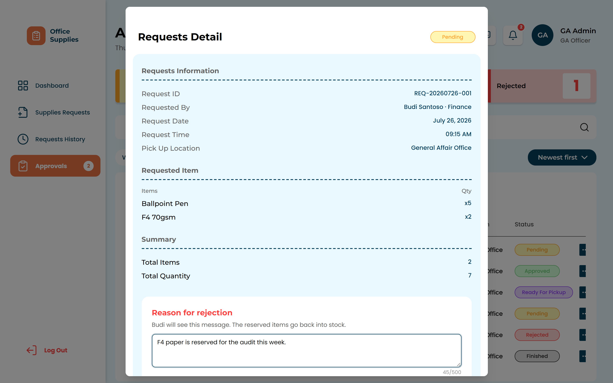
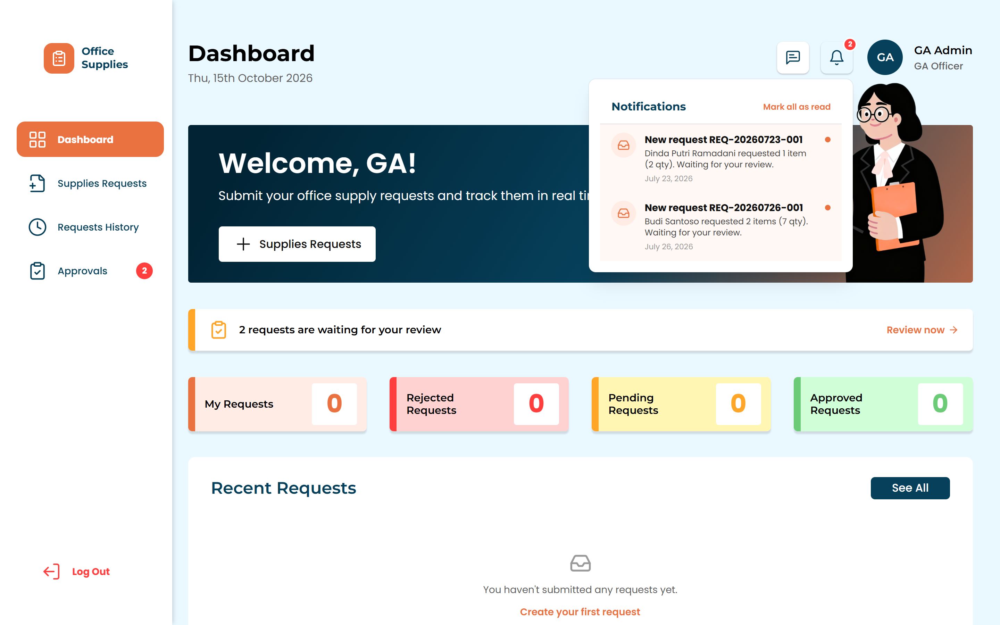
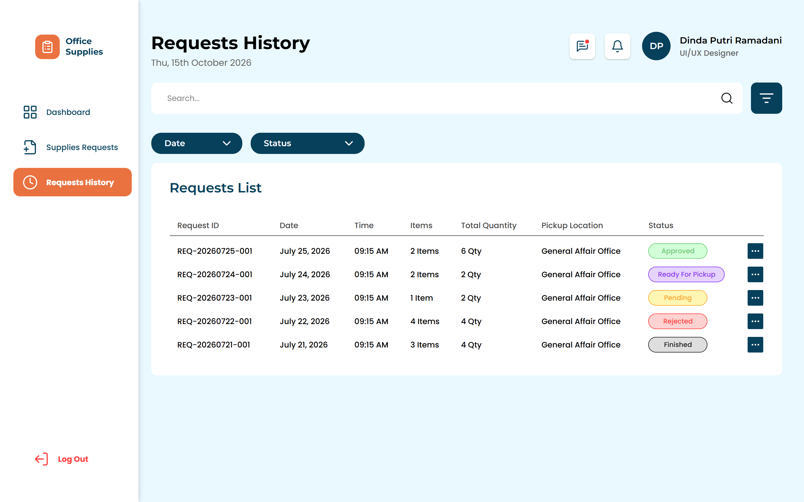
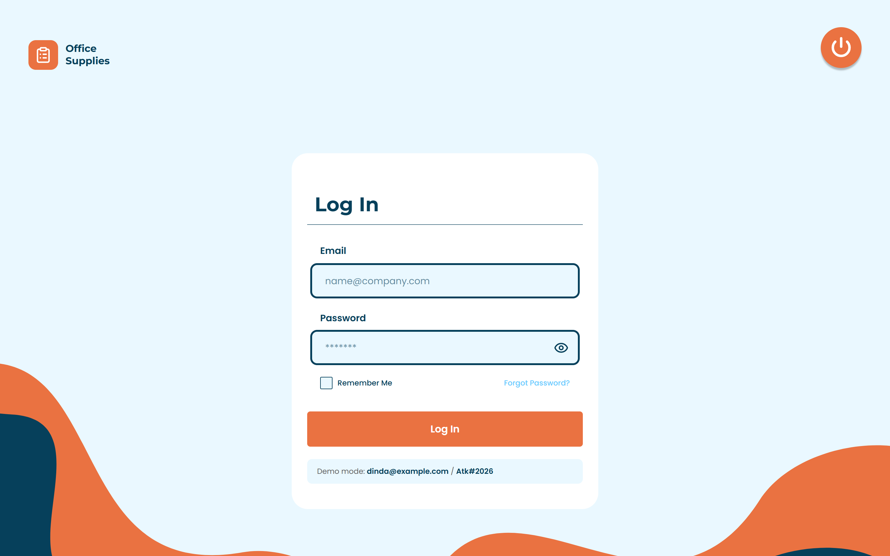
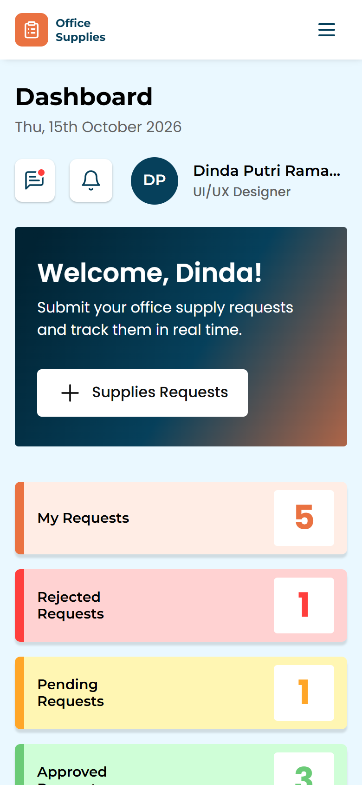
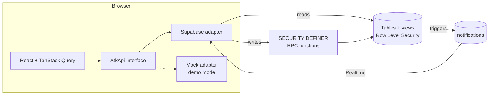
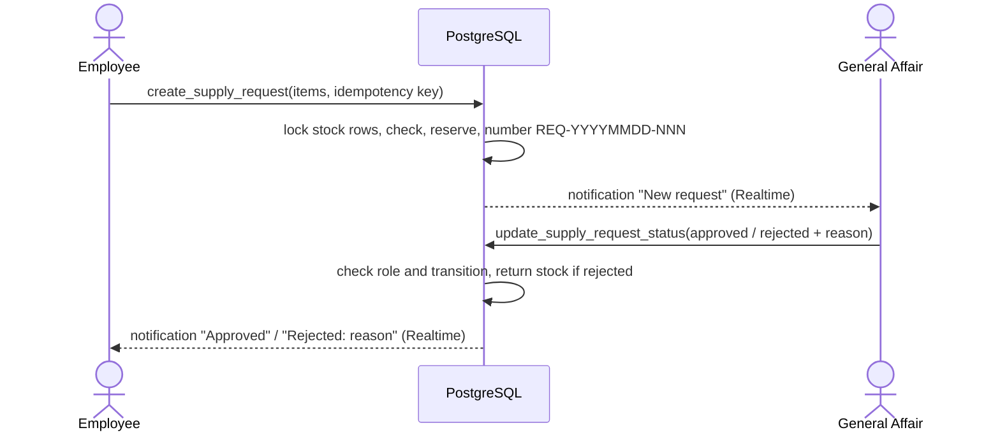

# Office Supplies Request

A full-stack web app for requesting office supplies inside a company. Employees browse the catalogue and submit requests; the General Affair team reviews them in an approval queue; both sides get real-time notifications at every step.



**Tech stack:** React 18 · TypeScript (strict) · Vite · Tailwind CSS · TanStack Query · React Router · Zod · Supabase (PostgreSQL, Row Level Security, RPC, Auth, Realtime) · Vitest · PGlite

## Features

**For employees**
- Browse the supplies catalogue with live stock, search and in-stock filter
- Build a request with several items at once and an optional note for General Affair; stock is reserved the moment it is submitted
- Track every request in a filterable history (status, date range, search)
- Get notified when a request is approved, rejected (with the reason) or ready for pickup

**For General Affair (admin)**
- Approval queue for every employee's requests, oldest first, with live counters
- Organisation-wide request history and dashboard, searchable by employee name
- Approve, reject with a required reason (stock is returned automatically), mark ready for pickup, mark handed over
- Notified instantly when a new request comes in; pending count shown in the sidebar and on the dashboard

| Catalogue & request summary | Approval queue |
| --- | --- |
|  |  |
| **Reviewing a request** | **Real-time notifications** |
|  |  |
| **Request history** | **Login** |
|  |  |

<p align="center"></p>

## Architecture

There is no custom API server. The React app talks to Supabase directly, and every business rule lives in PostgreSQL, where it can't be bypassed from the browser.





Request lifecycle:

```
pending ──approve──▶ approved ──prepare──▶ ready_for_pickup ──hand over──▶ finished
   └──────reject (reason required, stock returned)──────▶ rejected
```

## Engineering highlights

- **Security in the database, not the UI.** The browser only holds the publishable key. Row Level Security limits every read to the caller's own data (admins see everything), and all writes go through `SECURITY DEFINER` functions that validate input and check the role. An employee calling the API directly still can't approve a request, edit stock or read someone else's history.
- **No overselling under concurrency.** Submitting a request locks the stock rows in a fixed order (no deadlocks), checks every item, and reserves stock in one transaction. A second reviewer acting on a stale screen gets a `409` instead of a double decision.
- **Idempotent submissions.** Each cart carries an idempotency key, so double clicks and network retries never create duplicate requests. Reusing a key with a different cart is rejected.
- **Notifications that can't be faked.** Rows are written only by database triggers, read only by their recipient, and pushed live with Supabase Realtime (with a 30-second polling fallback).
- **One API interface, swappable backends.** Screens depend on a single typed `AtkApi`. Supabase, a REST client and an in-memory mock all implement it, so the whole app runs as a demo without any backend.
- **Validated at the boundary.** Every response is parsed with Zod; if the backend drifts from the contract, it fails loudly in one place instead of rendering `undefined`.
- **Accessible, responsive UI** built from a Figma design: native `<dialog>` modals with focus handling, keyboard-friendly controls, layouts from 375px to desktop, and URL-based filters that survive refresh.

## Testing

| Command | What it covers |
| --- | --- |
| `npm test` | 37 Vitest tests: cart rules, API contract, role rules, notifications, date formatting, error mapping |
| `npm run test:db` | 31 database tests: the real migrations run on in-memory PostgreSQL (PGlite) to check RLS isolation, anonymous lockout, stock reservation and rollback, idempotency, the status lifecycle, the approval race and notifications |
| `npm run typecheck` | TypeScript in strict mode |

## Run it locally

Requires Node.js 18+.

```bash
npm install
cp .env.example .env
```

**Demo mode (no backend).** Set `VITE_USE_MOCK=true` in `.env`, then `npm run dev` and open http://localhost:5173.

| Role | Email | Password |
| --- | --- | --- |
| Employee | `dinda@example.com` | `Atk#2026` |
| Employee | `budi@example.com` | `Atk#2026` |
| General Affair | `admin@example.com` | `Atk#2026` |

These accounts exist only in demo mode.

**With Supabase.**
1. Create a project at [supabase.com](https://supabase.com).
2. In the SQL Editor, run the whole of `supabase/setup.sql` once.
3. Under Authentication, turn off public sign-up and add users. Promote a General Affair user:
   `update public.profiles set role = 'admin' where email = '...';`
4. In `.env`, set `VITE_USE_MOCK=false`, `NEXT_PUBLIC_SUPABASE_URL` and `NEXT_PUBLIC_SUPABASE_PUBLISHABLE_KEY` (never the secret key).

More detail: [`supabase/README.md`](supabase/README.md) (schema, access matrix, error codes) and [`API_CONTRACT.md`](API_CONTRACT.md).

## Project structure

```
supabase/
  migrations/     schema, RLS policies, RPC functions, notification triggers
  tests/          database tests (PGlite)
  setup.sql       all migrations + seed, for one-shot setup
src/
  api/            Zod schemas, Supabase / mock / HTTP adapters, React Query hooks
  auth/           session handling, route guards (employee / admin)
  components/     layout (sidebar, header, notifications) and UI primitives
  features/       auth · dashboard · supplies · requests · approvals
  lib/            date formatting (Asia/Jakarta), helpers
```

## Possible next steps

- Admin screen for managing the catalogue and uploading product photos
- Email notifications alongside in-app ones
- Password reset flow and audit log
